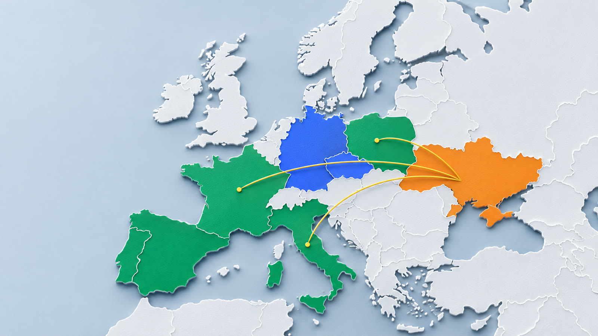
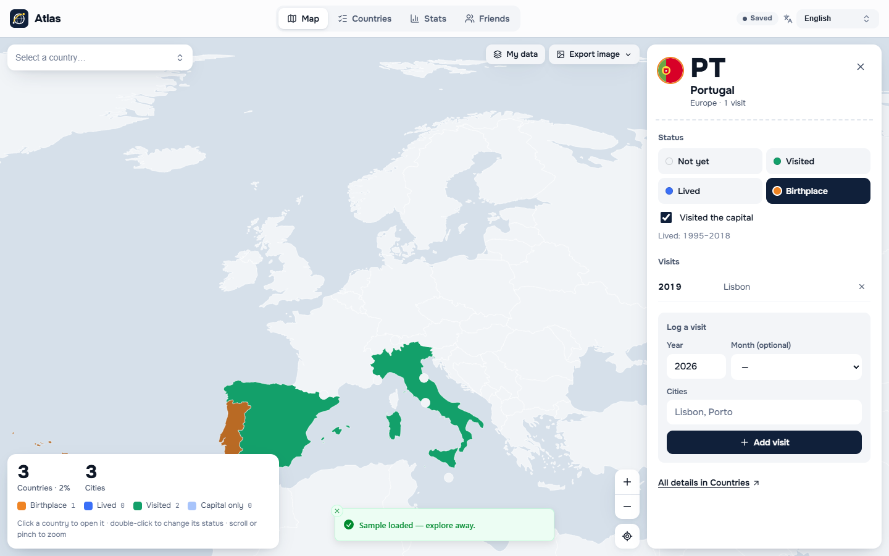
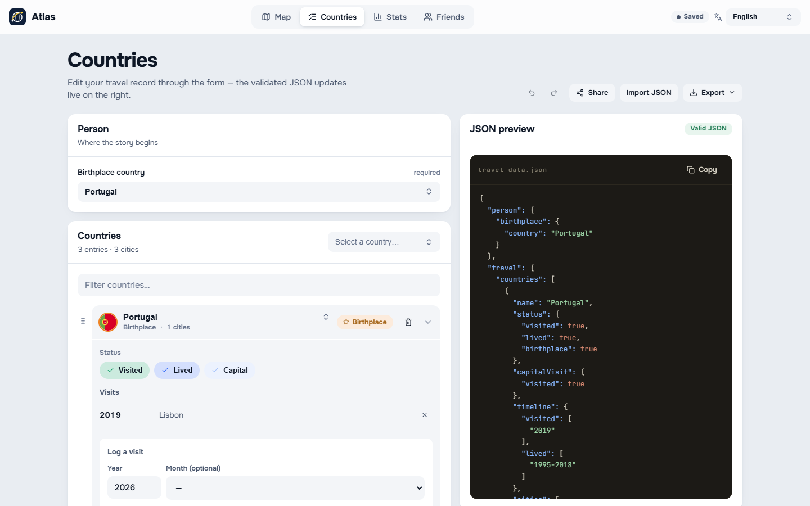
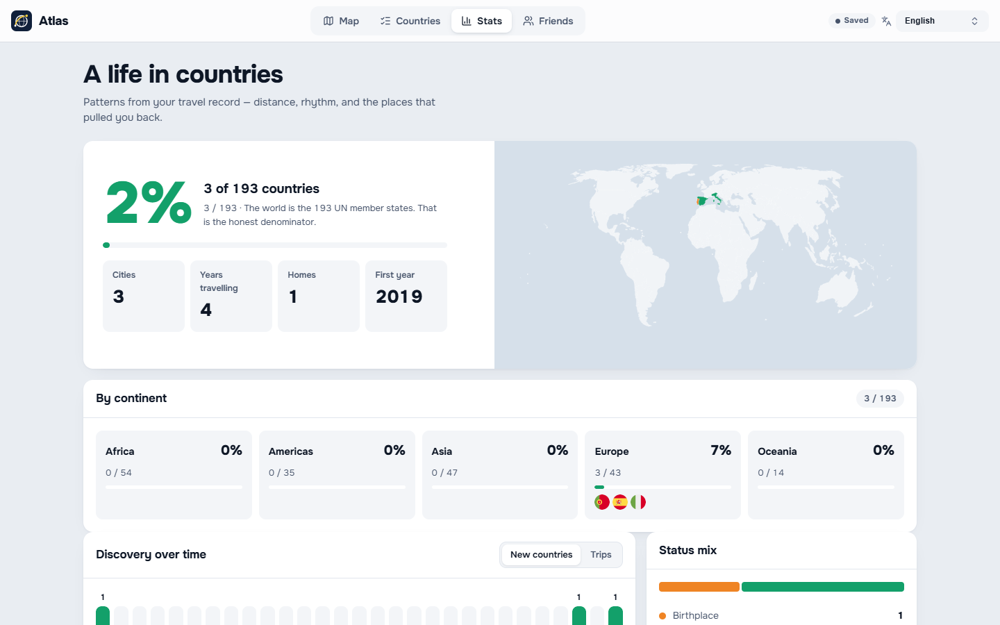
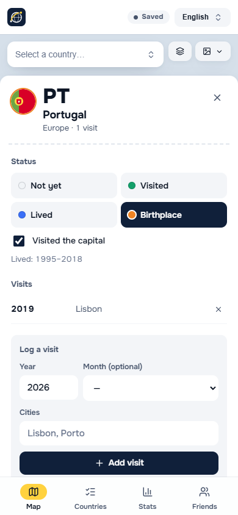

# Atlas

[](https://github.com/hlibsuslov/atlas-travel-editor/actions/workflows/ci.yml)
[](https://github.com/hlibsuslov/atlas-travel-editor/actions/workflows/codeql.yml)
[](https://github.com/hlibsuslov/atlas-travel-editor/actions/workflows/smoke-production.yml)
[](https://atlas-travel-editor.vercel.app)
[](LICENSE)
[](CONTRIBUTING.md)

Atlas is an open-source, local-first travel map and diary for the places you've lived and visited.



**[Open Atlas](https://atlas-travel-editor.vercel.app)** ·
[Documentation](docs/README.md) · [Project status](docs/PROJECT_STATUS.md)

## Why Atlas

Atlas saves your travel history in your browser by default, with no account required. After the
first load, the installable app works offline. Your whole record fits in one JSON document you own
and can export, back up, or move to another device. World progress uses the 193 UN member states
as its denominator.

## Screenshots



_Map. See where you've been and log a visit from the country panel._



_Countries. Edit your travel record alongside a live JSON preview._



_Stats. See your world coverage and travel patterns over time._



_Mobile. Log a trip from your phone._

## Features

- **Full-screen map.** Start in Europe and explore detailed Natural Earth 1:50m geometry with
  Crimea drawn as part of Ukraine. Search for a country or click it to open its panel.
  Double-click to cycle its status, and pinch or scroll to zoom.
- **Repeat visits.** Log the year, optional month, and cities in one step from the map or the
  Countries editor.
- **Clean JSON export.** Export chronological timelines with duplicate country and city entries
  merged. Import your document to restore or move your record.
- **Travel stats.** See your share of the world, progress by continent, a yearly chart of new
  countries or trips, your status mix, milestones, and cities ranked by how many years you visited.
- **Travel diary.** Record stays with dates, notes, and costs.
- **PNG map export.** Save your map as an image in several aspect ratios.
- **Offline PWA and eight locales.** Install Atlas for offline use. Choose English, German,
  Spanish, French, Italian, Portuguese, Russian, or Ukrainian.
- **Optional sharing and friends.** Connect a self-hosted [Atlas Server](#optional-atlas-server--accounts--sharing--social)
  to share read-only maps, follow people, and see their activity.

## Try it in 60 seconds

Open the [live app](https://atlas-travel-editor.vercel.app), select a country, and log a visit.
To explore with sample data, choose **Load a richer sample** in the welcome banner on Countries.

To run locally with Node.js 22 and npm:

```bash
git clone https://github.com/hlibsuslov/atlas-travel-editor.git
cd atlas-travel-editor
npm ci
npm run dev
```

Open `http://localhost:5173`. The local app runs without a backend or an
[environment file](.env.example).

## Stack

| Concern        | Choice                                           |
| -------------- | ------------------------------------------------ |
| Frontend       | React 18, strict TypeScript, Vite                |
| Map            | react-simple-maps, Natural Earth via world-atlas |
| State          | Zustand, TanStack Query                          |
| Validation     | Zod                                              |
| Storage        | IndexedDB behind the `DocumentStore` contract    |
| Server         | Node.js, Hono, built-in SQLite                   |
| Hosting and CI | Vercel, GitHub Actions, deployment smoke checks  |

See the [architecture overview](docs/ARCHITECTURE.md) and
[stack decision](docs/adr/0001-stack-and-architecture.md) for implementation details.

## Data model

One `TravelData` document holds your birthplace, country statuses and timelines, cities with
visited years, and optional diary entries. Export wraps that record in a versioned JSON envelope.
Atlas stores it in IndexedDB by default. On supported browsers you can work directly with a local
JSON file. JSON import and export are available across browsers.

See the [data model and compatibility guide](docs/DATA_MODEL.md) for the schema.

<a name="optional-atlas-server--accounts--sharing--social"></a>

## Optional Atlas Server

The self-hosted Atlas Server adds accounts and SQLite-backed storage. Share a read-only map by
link, publish a profile by handle, or follow friends and browse their activity.

```bash
docker compose up --build
```

In the app's storage picker, choose **Atlas Server** and enter `http://localhost:8787`.
See the [self-hosting guide](docs/SELF_HOSTING.md) and
[server operations guide](docs/SERVER_OPERATIONS.md).

## Scripts and quality gates

| Script                                         | Purpose                                          |
| ---------------------------------------------- | ------------------------------------------------ |
| `npm run dev` / `npm run preview`              | Start development or serve the production build  |
| `npm run build`                                | Typecheck and build to `dist/`                   |
| `npm run typecheck` / `npm run lint`           | Run TypeScript and ESLint checks                 |
| `npm run format:check` / `npm run format`      | Check or apply Prettier formatting               |
| `npm run check:docs` / `npm run check:locales` | Check documentation links and locale parity      |
| `npm run test` / `npm run test:coverage`       | Run frontend tests, with optional coverage       |
| `npm run ci`                                   | Run the full frontend quality gate               |
| `npm --prefix server run ci`                   | Check domain drift, typecheck, and run API tests |
| `npm run smoke:deploy -- URL`                  | Verify a deployed SPA, PWA, and response headers |

See the [development guide](docs/DEVELOPMENT.md) and [testing guide](docs/TESTING.md).

## Deployment

The frontend is a static PWA hosted on Vercel. GitHub Pages is an optional mirror, and other static
hosts can serve `dist/` with an SPA fallback. Deploy the Atlas Server separately with Docker.
See the [deployment runbook](docs/DEPLOYMENT.md).

## Contributing

Pull requests are welcome. Start with the [contribution guide](CONTRIBUTING.md) and
[code of conduct](CODE_OF_CONDUCT.md). For more project context, see the [product plan](docs/PRODUCT_PLAN.md),
[glossary](docs/GLOSSARY.md), [brand assets](docs/brand/BRAND.md), and
[architecture decisions](docs/adr/README.md).

## Security

Report vulnerabilities through the [security policy](.github/SECURITY.md).
See the [security model](docs/SECURITY.md) for the app's trust boundaries.

## License

[MIT](LICENSE)
